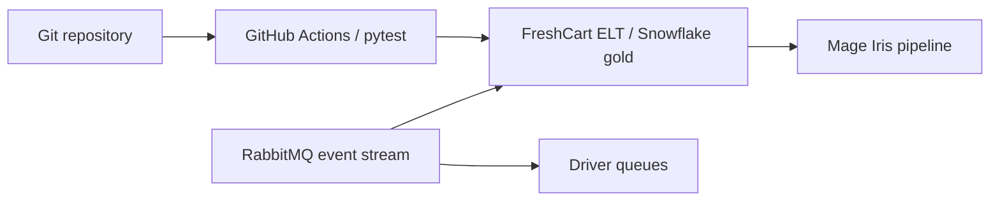
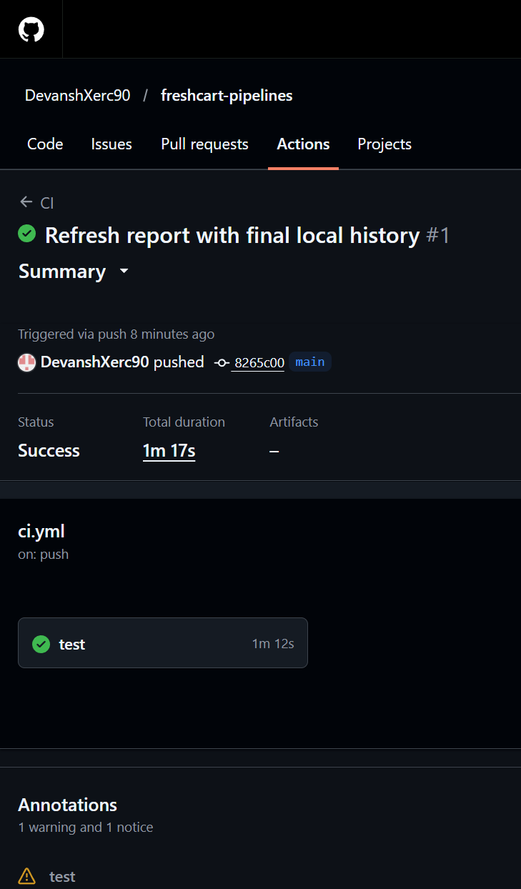
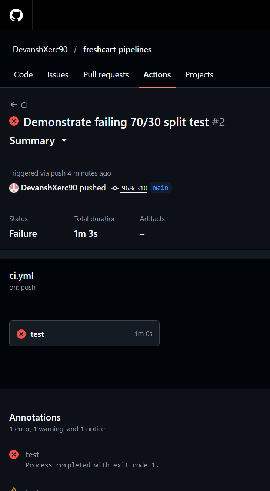

# From Git to Gold

**Draft status:** This report contains verified local tests and calculations from the supplied source. It is not submission-ready: Snowflake and live RabbitMQ runs, GitHub Actions screenshots, service-backed Mage runs, the student's own reflection, and identifying details are still required. No service outputs or screenshots have been fabricated.

## Part A: Git and CI/CD

### A1. Repository

Repository: https://github.com/DevanshXerc90/freshcart-pipelines

The project contains the required folders, CI workflow, tests, and unchanged reference notebooks. The following is the local `git log --oneline` before this report's final documentation update:

```text
fdabe4c Fix Iris split back to 80/20
968c310 Demonstrate failing 70/30 split test
8265c00 Refresh report with final local history
682ecd6 Add explicit notebook cell language metadata
e9bc756 Record milestone history in assignment report
047e3d4 Test all Iris accuracy gate depths
4b66bcc Add evidence-aware assignment report draft
9b6da22 Add instructor reference notebooks unchanged
c50567b Implement RabbitMQ topic stream handlers
8eccbba Implement credential-safe FreshCart ELT flow
3717bac Implement Mage Iris pipeline blocks
cd7cc42 Add Part A CI and prepare-data test
```

These twelve commits are pushed to `main`; the documentation update for this report adds another commit.

### A2. Git command table

| Command | Where the change happens | What exactly happens |
| --- | --- | --- |
| `git init` | Local `.git` repository | Initializes version tracking in the current folder. |
| `git add train.py` | Staging area | Selects the current file content for the next snapshot. |
| `git commit -m "msg"` | Local repository | Records staged content locally; GitHub is not updated. |
| `git remote add origin URL` | Local Git configuration | Saves the remote's name and URL. |
| `git push -u origin main` | Remote repository | Uploads local commits and sets the upstream branch. |
| `git pull origin main` | Working folder/local repository | Fetches and integrates commits from the remote branch. |

A teammate cannot see a local commit on GitHub until it is pushed, and must have access to the repository.

### A3. CI and split test

`tests/test_prepare_data.py` checks the required 120/30 split. Local evidence: with `test_size=0.3`, the test failed because only 105 rows were labeled train; restoring `0.2` made it pass. The local suite currently passes 15 tests. GitHub Actions run 1 passed on the initial 0.2 commit: [green run](https://github.com/DevanshXerc90/freshcart-pipelines/actions/runs/43636200024). Run 2 failed on the intentional 0.3 commit: [red run](https://github.com/DevanshXerc90/freshcart-pipelines/actions/runs/43636485505). The corrective 0.2 commit triggered run 3: [corrective run](https://github.com/DevanshXerc90/freshcart-pipelines/actions/runs/43636538786), still running at the time of this update. The run 1/2 screenshots are included in the appendix.

## Part B: FreshCart ELT

### B1. Baseline

The assignment's expected results are 8 raw order rows, 6 clean rows, 2 quarantined orders (ORD-1004 and ORD-1006), 4 deduplicated/gold orders, INR 7,785.00 revenue, 126 loyalty points, and 25% rejected. **Actual Snowflake run: not performed.** Credentials and a Snowflake trial account are required; fill this table only from the notebook's output.

| Check | Expected | Actual Snowflake result |
| --- | ---: | --- |
| Bronze order rows | 8 | Pending run |
| Clean rows | 6 | Pending run |
| Quarantine rows | 2 | Pending run |
| Deduplicated/gold orders | 4 | Pending run |
| Gold revenue / points | INR 7,785.00 / 126 | Pending run |
| Rejected share | 25% | Pending run |

### B2. Record trace

The website sends flat keys such as `order_id`, `cust_email`, `amount`, and `updated_at`; the mobile API uses nested/different keys such as `orderId`, `customer.email`, `total.value`, and `updatedAt`. `SQL_10_ORDERS_CLEAN` maps each source into unified columns, normalizes email/currency, parses dates and amounts, and records validation reasons. `SQL_20_ORDERS_DEDUP` uses `ROW_NUMBER()` partitioned by `order_id`, ordered by `updated_at DESC, ingest_seq DESC`, so the later mobile ORD-1003 version is selected.

From the sample values, ORD-1003's surviving amount is INR 2,100. The INR rate is 1.0, so `amount_inr = 2,100 × 1.0 = 2,100`. Meera's Platinum multiplier is 3, giving `floor(2,100 / 100) × 3 = 63` points. This is a calculation from the provided input, not a Snowflake query result.

For Priya, `dim.customers_scd2` is joined by normalized email and `order_date BETWEEN valid_from AND valid_to`. ORD-1001 on Sept. 1 uses Silver: `floor(1,250 / 100) × 1 = 12`. ORD-1005 on Sept. 3 uses Gold from that effective date: `floor(899 / 100) × 2 = 16`.

### B3. Currency validation

The cleaning SQL now adds `unsupported_currency` when the normalized currency is not INR or USD. Based on the supplied row and the original validation SQL, ORD-1006 already has `bad_email` and `bad_pincode`; with the added rule it should also have `unsupported_currency` for EUR. Its quarantine status means it does not enter gold, so the gold total should not change. The quarantine `NOT EXISTS` condition checks source, order ID, and updated timestamp to avoid adding the same rejected version twice. These are code-derived expectations; actual Snowflake reasons remain pending.

### B4. Arjun SCD2 change

Prediction from the supplied data: CUST-02 has two periods after adding the Gold event effective 2026-08-15; ORD-1002 on Sept. 1 then uses Gold. `USD 42.50 × 83.20 INR/USD = INR 3,536.00`; `floor(3,536 / 100) × 2 = 70` points. This is 35 points more than the prior Silver multiplier, so the predicted gold total is 161. One matched gold row, ORD-1002, should have a changed hash and `published_at`. Actual comparison after Snowflake run: pending.

### B5. Sixth data-quality check

The sixth check counts `silver.orders_dedup` rows where `order_date > CURRENT_DATE()`. The notebook uses the isolated `FRESHCART_B5_TEST` database by default and offers a test-only future-dated order with no amount, a valid customer and pincode. Capture actual `PROBLEM` output, then run the notebook cleanup cell. The intentional service run is pending.

Discussion draft to restate in your own words: ELT retains raw source records and uses Snowflake's scalable SQL compute for repeated transformations, which helps when incoming data is messy and business rules evolve. ETL can be preferable when sensitive data must be filtered or transformed before it is allowed into the destination. Confirm the specific ETL example against the lecture.

## Part C: Mage ML pipeline

### C1. Graph

```text
load_iris (data_loader; row-count test)
  -> validate_iris (transformer; missing-value/class test)
  -> prepare_data (transformer; 120/30 split test)
  -> train_model (transformer; accuracy >= 0.8 test)
       -> save_results (data_exporter; output test)
       -> evaluate_model (transformer; metrics test)
```

Mage CLI/UI execution and graph screenshot: pending because Mage installation was canceled during dependency resolution. The individual block functions were tested locally outside Mage.

### C2. Local Python experiment

These are actual results from direct local calls to the implemented split/model functions; they are not Mage CLI runs. The local tests verify the accuracy threshold and CSV export gate for each depth.

| max_depth | Accuracy | Gate | Predictions CSV |
| ---: | ---: | --- | --- |
| 1 | 0.633 | Fails | No |
| 2 | 0.967 | Passes | Yes |
| 3 | 1.000 | Passes | Yes |
| 4 | 1.000 | Passes | Yes |
| 5 | 1.000 | Passes | Yes |

The `train_model` block's `@test` is checked before downstream exporters execute, so a failed threshold prevents `save_results` from running in Mage. Local tests confirm the same gate/export order at function level.

### C3. Evaluation branch

The pipeline metadata branches `train_model` to both `save_results` and `evaluate_model`. Direct local Python evaluation at depth 3 produced this confusion matrix and metrics; these are not Mage UI/run evidence.

| Actual \\ Predicted | 0 | 1 | 2 |
| --- | ---: | ---: | ---: |
| 0 | 10 | 0 | 0 |
| 1 | 0 | 9 | 0 |
| 2 | 0 | 0 | 11 |

Accuracy, macro precision, macro recall, and macro F1 were each 1.000 in that local call. Capture Mage's own output and UI screenshot after running the pipeline.

### C4. Additional block

`validate_iris` checks for missing values and exactly three target classes. Its block test is included, and the local integration test passes.

## Part D: RabbitMQ stream

### D1. Routing table

| Routing key | Receiving queues |
| --- | --- |
| `bangalore.koramangala.food` | Ravi, Meena, Control |
| `bangalore.indiranagar.ride` | Priya, Arjun, Control |
| `bangalore.whitefield.ride` | Arjun, Control |
| `chennai.tnagar.food` | Karthik |
| `chennai.whitefield.ride` | Dropped |
| `bangalore.koramangala` | Control |

The final key has two words. `bangalore.#` matches because `#` can match zero or more words after `bangalore`; bindings ending in `*` or with three required words do not match a two-word key. The local routing tests pass. Live broker delivery is pending.

### D2-D3. Scripts and acknowledgements

`stream/dispatcher.py` publishes to the `rapido-dispatch` topic exchange using `RABBITMQ_URL`; every tenth payload omits `zone`. `stream/driver.py NAME PATTERN` declares an exclusive private queue and binding, ACKs valid requests, and NACKs missing-zone messages with `requeue=False`. Local tests exercise the routing table and both ACK/NACK branches. Console captures from a two-minute RabbitMQ run are pending because no broker is configured.

With manual acknowledgements, if a consumer connection closes before ACK, RabbitMQ can requeue the unacknowledged message for redelivery. A permanently invalid message with `requeue=True` can loop repeatedly; `requeue=False` discards it unless a dead-letter exchange is configured.

## Part E: Integration and reflection



**Personal reflection (write this yourself after your own run):** Describe one failure you personally observed, the evidence you used to locate its cause, and how you fixed it. Do not reuse the agent's local tooling issue as a personal experience unless you investigated and can explain it yourself.

## Bonus

Not implemented. It needs a defined FreshCart message payload, a running RabbitMQ broker, and Snowflake credentials to validate end-to-end. No duplicate-free totals are claimed.

## Appendix: GitHub Actions screenshots





## Evidence still needed

1. Run FreshCart baseline, validation, SCD2, idempotency, and B5 cells in Snowflake; paste actual outputs and screenshots.
2. Install Mage dependencies in a supported environment (the reference notebook uses Colab), run depths 1–5 with `mage run`, and capture Mage output/UI graph.
3. Run dispatcher and at least three drivers against RabbitMQ for two minutes; capture matching output and invalid-message handling.
4. Confirm the corrective GitHub Actions run is green and capture its screenshot if desired; the initial green and intentional red screenshots are included above.
5. Add your own reflection and replace the report filename placeholder with your roll number and name.
